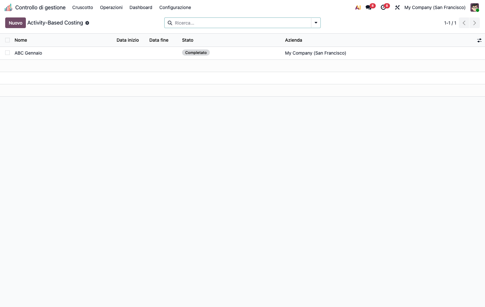
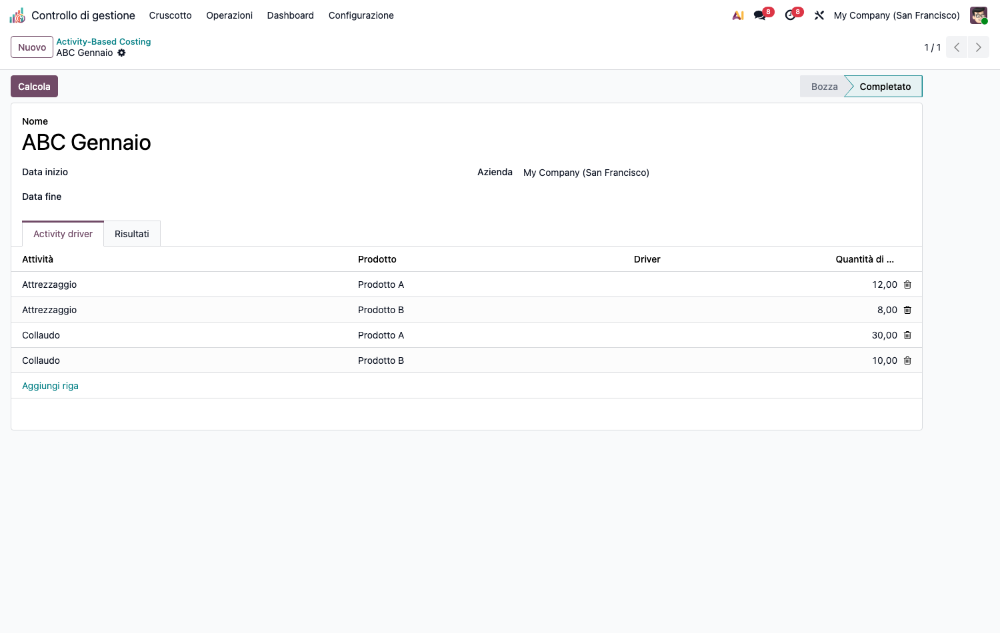
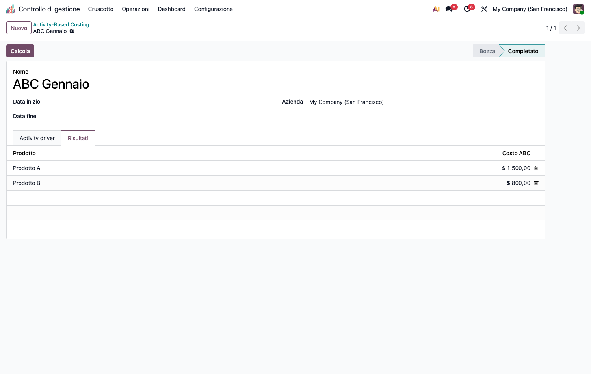

# CMC – Activity-Based Costing (cmc_abc)

Modulo capillare della suite CMC. Dipende da `cmc_base` e `product`.

## Obiettivo

Costeggiare i prodotti con l'**ABC classico a due stadi**:

- **Stadio 1** – i costi delle risorse confluiscono nei **pool di attività** tramite il
  tag `Attività ABC` sulle righe analitiche.
- **Stadio 2** – ogni pool di attività si ribalta sugli **oggetti di costo** (prodotti)
  in proporzione alle **quantità di driver** consumate, con conservazione dei totali
  (`largest_remainder`).

## Configurazione (step-by-step)

1. Installa `cmc_abc` (richiede `cmc_base`).
2. Vai in **Configurazione › Anagrafiche › ABC Activities** e crea le **attività**
   (es. *Attrezzaggio*, *Collaudo*) con codice e (opzionale) driver di default.
3. **Tagga i costi**: nelle righe analitiche di costo (*Base di costo › Registrazione
   costi*) valorizza il campo **Attività ABC** per far confluire quel costo nel pool
   dell'attività (stadio 1).

## Utilizzo (step-by-step)

1. **Operazioni › Activity-Based Costing › Calcolo ABC** → **Nuovo**.

   

2. (Opzionale) imposta il periodo *Date From / Date To* per delimitare i pool.
3. Nel tab **Driver attività** aggiungi le righe *attività × prodotto × quantità driver*
   (quanto ogni prodotto consuma di ciascuna attività).
4. Premi **Calcola**. Il tab **Risultati** mostra il costo ABC per prodotto.

   

## Note

- I pool sono aggregati direttamente sulla colonna-tag (`_read_group`), non plan-aware:
  il tag attività è un'unica colonna sulla riga analitica.
- I costi possono essere negativi: il pool è letto in valore assoluto.
- Ricalcolo idempotente (lock `FOR UPDATE`, unlink+create).
- Per l'evoluzione **Time-Driven ABC** (capacità, tariffa €/min, time equations, capacità
  inutilizzata) vedi il modulo `cmc_tdabc`.
