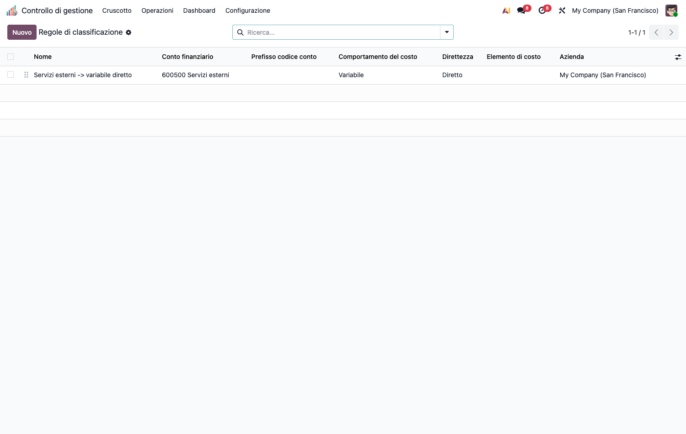

# CMC – Integrazione Contabile (cmc_account)

Modulo **ponte** della suite CMC. Dipende da `cmc_base` e `account`.

## Obiettivo

Alimentare il controllo di gestione con i **dati reali della contabilità**: le righe
analitiche generate dalla co.ge. vengono **classificate automaticamente** secondo la
tassonomia CMC (comportamento, diretto/indiretto, elemento di costo), così da entrare
nella base di costo senza doppia imputazione.

## Configurazione (step-by-step)

La classificazione automatica di ogni riga analitica combina **due strati** (non sono
alternative: lavorano insieme sulla stessa riga).

1. Installa `cmc_account` (richiede `cmc_base` + `account`).

2. **Strato 1 — Mappatura conto → elemento** (assegna *solo l'elemento di costo*). Apri un
   conto (*Contabilità › Configurazione › Piano dei conti*) e valorizza **Elemento di costo
   CMC**. È la scorciatoia "questo conto è **sempre** questa natura di costo" (es. conto
   *600100 Materie prime* → elemento *MP*). La mappatura **non** dice se il costo è
   fisso/variabile o diretto/indiretto: solo la natura.

3. **Strato 2 — Regole di classificazione** (assegnano *il resto*: comportamento e
   diretto/indiretto, più l'elemento come **ripiego**). *Controllo di gestione ›
   Configurazione › Integrazione contabile › Classification Rules* → **Nuovo**.
   - **Match** (lascia vuoto = qualsiasi): conto, prefisso codice conto, categoria
     prodotto, partner, centro.
   - **Assegna** (solo fill): comportamento (fisso/variabile), diretto/indiretto, e —
     solo se lo Strato 1 non ha già dato l'elemento — l'elemento di costo.
   - L'ordine (**sequence**) determina la priorità: la prima regola che combacia vince.

   **Come si combinano su una riga**: prima la mappatura del conto fissa l'elemento; poi la
   prima regola che combacia aggiunge comportamento e diretto/indiretto. Se il conto era
   muto sull'elemento, ci pensa la regola. Perciò tipicamente usi la **mappatura** per la
   natura del costo (stabile, per conto) e le **regole** per comportamento e direttezza
   (dipendono dal contesto: centro, partner, categoria prodotto). Regola *fill-only*: non
   sovrascrive mai un valore già presente.

## Utilizzo (step-by-step)

1. Registra normalmente in contabilità con conto analitico: alla creazione della riga
   analitica scatta l'**auto-classificazione** (`_cmc_auto_classify`) secondo le regole.
2. **Verifica gli scoperti**: *Operazioni › Analisi & controllo › Unclassified Cost Lines*
   elenca le righe non ancora classificate — aggiungi/riordina le regole finché la lista
   si svuota.
3. Le righe classificate confluiscono automaticamente nella base di costo di `cmc_base`
   (registrazione costi, ribaltamento, quadro analisi).

## Note

- La classificazione manuale (`cmc_classified_manually`) ha la precedenza e non viene
  sovrascritta dalle regole, **e sopravvive al ciclo bozza → ripubblicazione**: Odoo
  cancella le righe analitiche quando una registrazione torna in bozza e ne crea di nuove
  al ripristino, quindi l'override manuale viene conservato sulla **scrittura contabile**
  (`account.move.line`) e ri-applicato alla riga ricreata.
- La classificazione si ri-innesca anche **in scrittura** (non solo alla creazione): se
  cambia il conto, il prodotto, il partner o il centro di una riga non manuale, le regole
  vengono ri-applicate.
- La coda *Unclassified Cost Lines* elenca **tutte** le righe di costo senza comportamento
  (contabilità, timesheet, produzione) ed esclude i ricavi.
- Base per i ponti operativi `cmc_hr_timesheet` (manodopera da timesheet) e `cmc_mrp`
  (costo primo da produzione), che ne estendono l'auto-classificazione.
