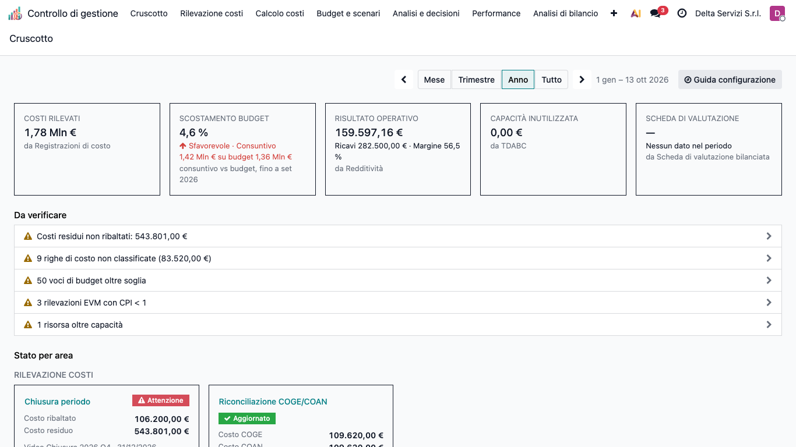
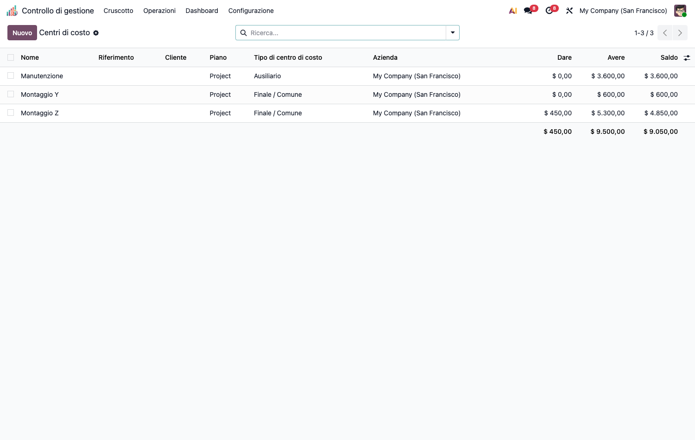
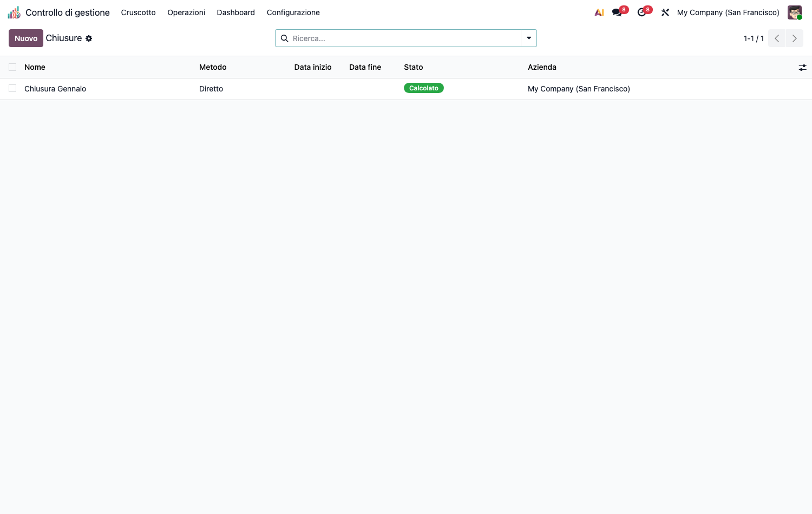
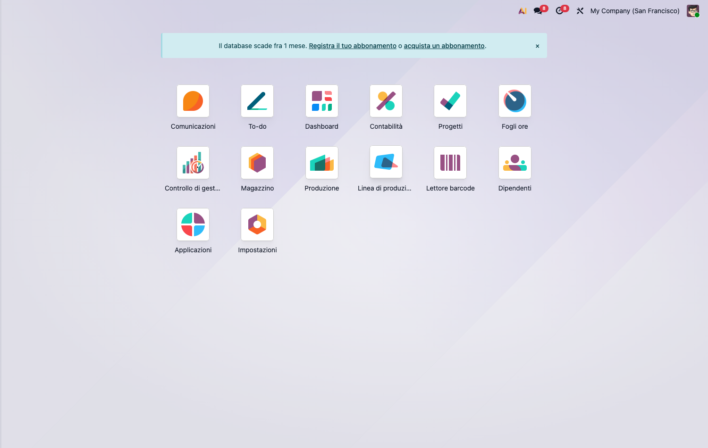
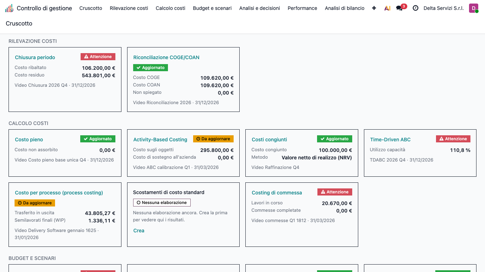
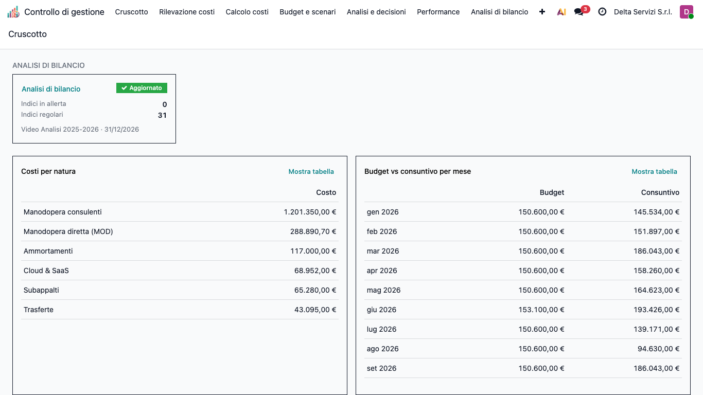

# CMC – Controllo di Gestione (cmc_base)

Modulo **core** della suite CMC (Cost Management & Controlling) per Odoo 19 Community.
Applica i principi della contabilità analitica e del controllo di gestione. Tutti gli
altri moduli della suite dipendono da questo.

## Obiettivo

Costruire la **base di costo** su cui poggiano tutte le metodologie di costing:

- **Tassonomia dei costi** (natura/elemento, comportamento fisso/variabile, diretto/indiretto)
  e **oggetto di costo** (speciale/comune, relativo al contesto).
- **Centri di costo** (finali, ausiliari, di periodo) sul piano analitico nativo.
- **Ribaltamento** dei centri ausiliari sui finali (diretto, step-down, reciproco con solver).
- **Analisi di capacità** con isolamento del costo della capacità inutilizzata (*idle cost*).
- **Quadro di analisi dei costi** (matrice centro × elemento) e **Cruscotto** del controller (indicatori, anomalie, stato delle elaborazioni).

## Configurazione (step-by-step)

1. **Installa** `cmc_base` (le app capillari si installano sopra, quando servono).
2. Assegna all'utente il gruppo **Controllo di gestione / Manager** (o Utente) da
   *Impostazioni › Utenti*.
3. Vai in **Controllo di gestione › Configurazione › Struttura dei costi**:
   - **Elementi di costo** (*Cost Elements*): crea la tassonomia per natura
     (es. Materie prime, Manodopera diretta, Ammortamenti). Marca come *figurativo*
     gli elementi che non transitano in co.ge. (es. interessi di computo).
   - **Cost Driver**: crea le basi di ripartizione (es. *Ore macchina*, *Ore servizio*).
4. In **Rilevazione costi › Base di costo › Centri di costo** crea i centri e assegna il
   **Tipo di centro** (finale / ausiliario) oppure marca *centro di periodo* per i
   costi che restano fuori dal ribaltamento (es. Commerciale).

   

## Utilizzo (step-by-step)

1. **Registra i costi**: *Rilevazione costi › Base di costo › Registrazioni di costo* — ogni riga
   analitica porta centro, importo, comportamento ed elemento di costo.
2. **Servizi inter-centro**: *Rilevazione costi › Base di costo › Servizi inter-centro* — dichiara le
   prestazioni dei centri ausiliari verso gli altri centri (provider → receiver, driver, quantità).
3. **Ribaltamento**: *Rilevazione costi › Base di costo › Ripartizioni di costo* → nuovo record, scegli il **Metodo**
   (diretto / step-down / reciproco) e premi **Calcola**. I centri ausiliari si azzerano
   sui finali; la matrice centro × elemento viene generata.

   

4. **Capacità**: *Analisi e decisioni › Analisi dei costi › Analisi di capacità* → inserisci capacità teorica,
   pratica e consuntiva del centro; il sistema isola il **costo della capacità inutilizzata**
   (costi fissi su base pratica).

   

5. **Cruscotto**: *Cruscotto* (home della suite) riepiloga periodo, indicatori, anomalie e stato
   delle elaborazioni (vedi la sezione seguente). La guida alla configurazione è in
   *Configurazione › Guida configurazione*.

## Cruscotto

Il **Cruscotto** (prima voce del menu *Controllo di gestione*) è la pagina di apertura del
controller: in pochi secondi mostra se i numeri del periodo sono completi e dove qualcosa
non torna, con un clic per andare al dettaglio.

### Periodo

In alto si sceglie il periodo: **Mese**, **Trimestre**, **Anno** o **Tutto**. Le frecce
laterali spostano al periodo precedente o successivo; accanto compare l'intervallo di date.
All'apertura è selezionato l'anno in corso.

Se il periodo comprende la data odierna, i valori vanno **da inizio periodo a oggi** e il
confronto è con **le stesse date dell'anno precedente**. Con *Tutto* il confronto non è
presentato. Budget e scheda di valutazione sono mensili: nel periodo in corso contano solo i
**mesi già chiusi** (la scheda Budget indica «fino a set 2026»); se nessun mese è ancora chiuso
mostrano «—».

### Indicatori principali

Fino a cinque riquadri, ciascuno con la fonte indicata in piccolo (es. «da Redditività»):

- **Costi rilevati**: costi classificati del periodo, con variazione rispetto all'anno
  precedente. Le righe non ancora classificate non sono incluse (compaiono tra le anomalie).
- **Scostamento budget**: calcolato **sui soli costi**, come (consuntivo − budget) / budget;
  indica se è favorevole o sfavorevole. Richiede il modulo Budget.
- **Risultato operativo**: dalla Redditività; se non disponibile, dal Direct costing.
- **Capacità inutilizzata**: dal primo disponibile nell'ordine Time-Driven ABC, Activity-Based
  Costing, Analisi di capacità.
- **Scheda di valutazione**: punteggio della scheda bilanciata, con variazione in punti
  rispetto alla rilevazione precedente.

### Da verificare

Elenco delle anomalie, dalle più gravi alle meno gravi (ad es. KPI in rosso, costi residui non
ribaltati, righe di costo non classificate, voci di budget oltre soglia). Se ne vedono cinque;
**Mostra tutti (N)** apre l'elenco completo. Facendo clic su una riga si apre l'elenco
già filtrato, con **lo stesso numero di righe** indicato nel messaggio. Se non ci sono
anomalie compare «Nessuna anomalia nel periodo».

### Stato per area

Sotto, una scheda per ogni elaborazione, raggruppate per area (le stesse del menu:
Rilevazione costi, Calcolo costi, Budget e scenari, Analisi e decisioni, Performance, Analisi di
bilancio). Ogni scheda mostra uno stato; facendo clic si apre l'elenco delle elaborazioni.

| Stato | Significato |
|---|---|
| **Aggiornato** | L'ultima elaborazione completata copre la fine del periodo. |
| **Da aggiornare** | L'ultima elaborazione termina prima della fine del periodo: va rieseguita. |
| **Attenzione** | Per quell'area c'è almeno un elemento in *Da verificare*. |
| **Nessuna elaborazione** | Il modulo è installato ma non è ancora stata fatta alcuna elaborazione. Il collegamento **Crea** permette di avviarne una. |

### Grafici

In fondo due grafici: **Costi per natura** (primi otto elementi più «Altri») e **Budget vs
consuntivo per mese** (non mostrato con *Mese*; con *Tutto* raggruppa per anno). Il collegamento
**Mostra tabella** affianca ai grafici i valori in forma di tabella.

### Cosa si vede: moduli e permessi

Il Cruscotto si adatta a ciò che è installato e a ciò che l'utente può consultare. Indicatori,
anomalie, schede e grafici relativi a moduli non installati, o a dati per cui l'utente non ha
diritto di lettura, **non vengono mostrati** (mai come zero). Con la sola base compaiono
*Costi rilevati*, *Capacità inutilizzata* e le relative anomalie e schede.

### Guida configurazione

La guida passo-passo alla configurazione non è più nel Cruscotto: si apre con il pulsante
**Guida configurazione** in alto a destra, oppure dal menu **Configurazione › Guida
configurazione** (riservato ai manager).

### Domande frequenti

- **Manca un indicatore.** Il modulo che lo alimenta non è installato, non contiene ancora dati,
  oppure l'utente non ha accesso. Se più moduli possono fornire lo stesso indicatore, è usato
  il primo disponibile.
- **Un indicatore mostra «—».** Esistono dati, ma non nel periodo selezionato
  («Nessun dato nel periodo»). Cambiare periodo o eseguire l'elaborazione.
- **Una scheda dice «Da aggiornare».** L'ultima elaborazione non arriva a fine periodo:
  aprire la scheda ed eseguirne una nuova.
- **Il numero nell'anomalia non coincide con quello che ricordo.** I valori dipendono dal periodo
  selezionato e dall'azienda corrente: verificare entrambi.

## Note

- I centri di costo vivono sul **piano analitico** con colonna `account_id` (piano non-default).
- Arrotondamenti a conservazione tramite `cmc_utils.largest_remainder` (usato da tutta la suite).
- Il Cruscotto rileva **a runtime** quali moduli capillari sono installati e quali dati l'utente
  può leggere: mostra solo ciò che è effettivamente disponibile.

## Note di sicurezza (2026-09-17)

- Il hook che tiene allineate le analisi di capacità gira in `sudo()` su
  `account.analytic.line`: qualunque utente registra righe analitiche
  (timesheet, fatture fornitore, produzione), mentre `cmc.capacity.analysis` è
  dato riservato ai gruppi CMC. Senza `sudo()` installare `cmc_base` renderebbe
  i diritti CMC un prerequisito per registrare una riga analitica.
- ACL `1,0,1,1` (lettura + creazione + cancellazione, senza scrittura) su
  `cmc.closing.line` e `cmc.cost.analysis.line`: le righe di risultato non
  vengono mai modificate sul posto, il motore le ricostruisce con
  `unlink()` + `create()`. Il CSV delle ACL non ammette commenti, la nota sta qui.
