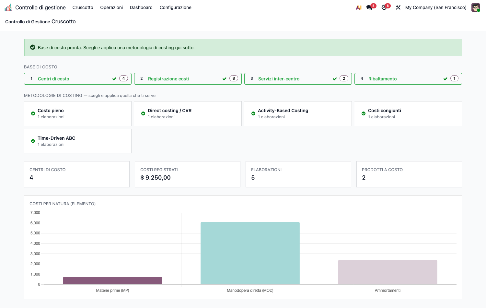

# CMC – Controllo di Gestione (cmc_base)

Modulo **core** della suite CMC (Cost Management & Controlling) per Odoo 19 Community.
Applica i principi della contabilità analitica e del controllo di gestione. Tutti gli
altri moduli della suite dipendono da questo.

## Obiettivo

Costruire la **base di costo** su cui poggiano tutte le metodologie di costing:

- **Tassonomia dei costi** (natura/elemento, comportamento fisso/variabile, diretto/indiretto)
  e **oggetto di costo** (speciale/comune, relativo al contesto).
- **Centri di costo** (finali, ausiliari, di periodo) sul piano analitico nativo.
- **Ribaltamento** dei centri ausiliari sui finali (diretto, step-down, reciproco con solver).
- **Analisi di capacità** con isolamento del costo della capacità inutilizzata (*idle cost*).
- **Quadro di analisi dei costi** (matrice centro × elemento) e **cruscotto** OWL di regia.

## Configurazione (step-by-step)

1. **Installa** `cmc_base` (le app capillari si installano sopra, quando servono).
2. Assegna all'utente il gruppo **Controllo di gestione / Manager** (o Utente) da
   *Impostazioni › Utenti*.
3. Vai in **Controllo di gestione › Configurazione › Anagrafiche**:
   - **Elementi di costo** (*Cost Elements*): crea la tassonomia per natura
     (es. Materie prime, Manodopera diretta, Ammortamenti). Marca come *figurativo*
     gli elementi che non transitano in co.ge. (es. interessi di computo).
   - **Cost Driver**: crea le basi di ripartizione (es. *Ore macchina*, *Ore servizio*).
4. In **Operazioni › Base di costo › Centri di costo** crea i centri e assegna il
   **Tipo di centro** (finale / ausiliario) oppure marca *centro di periodo* per i
   costi che restano fuori dal ribaltamento (es. Commerciale).

   

## Utilizzo (step-by-step)

1. **Registra i costi**: *Operazioni › Base di costo › Registrazione costi* — ogni riga
   analitica porta centro, importo, comportamento ed elemento di costo.
2. **Servizi inter-centro**: *Base di costo › Servizi inter-centro* — dichiara le
   prestazioni dei centri ausiliari verso gli altri centri (provider → receiver, driver, quantità).
3. **Ribaltamento**: *Base di costo › Ribaltamento* → nuovo record, scegli il **Metodo**
   (diretto / step-down / reciproco) e premi **Calcola**. I centri ausiliari si azzerano
   sui finali; la matrice centro × elemento viene generata.

   

4. **Capacità**: *Analisi & controllo › Unused Capacity* → inserisci capacità teorica,
   pratica e consuntiva del centro; il sistema isola il **costo della capacità inutilizzata**
   (costi fissi su base pratica).

   

5. **Cruscotto**: *Cruscotto* (home della suite) mostra la pipeline della base di costo,
   le metodologie installate, i KPI e il grafico costi per natura. È il punto di partenza:
   completa la pipeline (Centri → Costi → Servizi → Ribaltamento), poi applica una o più
   metodologie di costing (moduli capillari).

## Note

- I centri di costo vivono sul **piano analitico** con colonna `account_id` (piano non-default).
- Arrotondamenti a conservazione tramite `cmc_utils.largest_remainder` (usato da tutta la suite).
- Il cruscotto rileva **a runtime** quali moduli capillari sono installati: mostra solo le
  metodologie effettivamente disponibili.

## Note di sicurezza (2026-09-17)

- Il hook che tiene allineate le analisi di capacità gira in `sudo()` su
  `account.analytic.line`: qualunque utente registra righe analitiche
  (timesheet, fatture fornitore, produzione), mentre `cmc.capacity.analysis` è
  dato riservato ai gruppi CMC. Senza `sudo()` installare `cmc_base` renderebbe
  i diritti CMC un prerequisito per registrare una riga analitica.
- ACL `1,0,1,1` (lettura + creazione + cancellazione, senza scrittura) su
  `cmc.closing.line` e `cmc.cost.analysis.line`: le righe di risultato non
  vengono mai modificate sul posto, il motore le ricostruisce con
  `unlink()` + `create()`. Il CSV delle ACL non ammette commenti, la nota sta qui.
