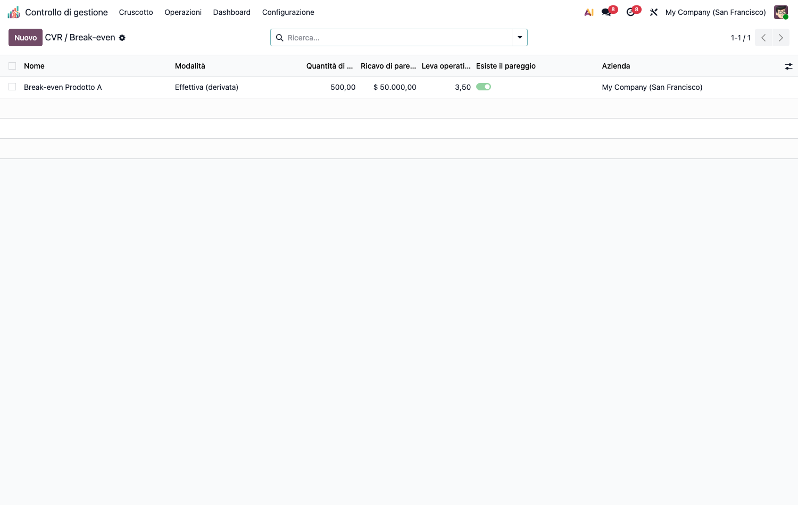
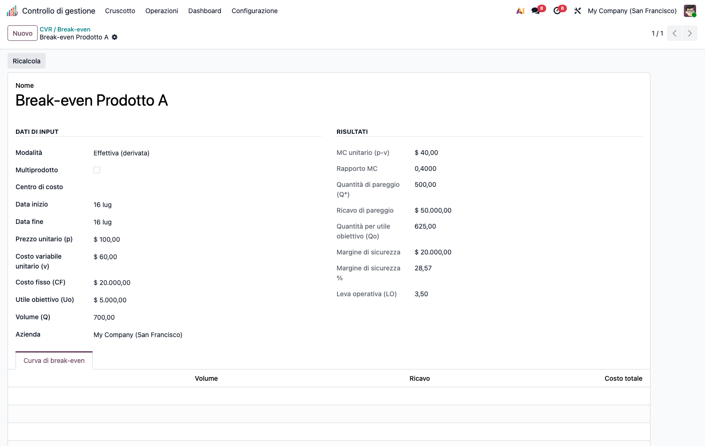

# CMC – Direct Costing & Decisioni (cmc_direct_costing)

Modulo capillare della suite CMC. Dipende da `cmc_base`.

## Obiettivo

Strato **decisionale** basato sul margine di contribuzione (direct costing):

- **Direct costing** semplice ed evoluto: margine di contribuzione lordo e semilordo
  per linea/prodotto.
- **CVR / break-even**: punto di pareggio, utile obiettivo, margine di sicurezza,
  **leva operativa**. Modalità *consuntivo* (costi fissi dai gruppi di costo) o *simulazione*.
- **Analisi differenziale**: wizard make-or-buy, eliminazione linea, sostituzione
  prodotto, con verdetto live.

## Configurazione (step-by-step)

1. Installa `cmc_direct_costing` (richiede `cmc_base`).
2. Nessuna anagrafica dedicata obbligatoria: i dati si inseriscono nelle analisi.
   Per la modalità *consuntivo* servono costi registrati in `cmc_base`
   (i costi fissi sono derivati dai gruppi di costo).

## Utilizzo (step-by-step)

### Direct costing (margine di contribuzione)
1. **Operazioni › Direct costing & decisioni › Direct Costing (MC)** → **Nuovo**.
2. Aggiungi le righe (prodotto/linea): ricavo, costo variabile, costo fisso specifico.
3. Imposta il costo fisso comune. Il sistema calcola MC lordo/semilordo e risultato.

### CVR / break-even
1. **Operazioni › Direct costing & decisioni › CVR / Break-even** → **Nuovo**.

   

2. Inserisci prezzo unitario, costo variabile unitario, costi fissi, volume e
   (opzionale) utile obiettivo.
3. Il record calcola break-even (quantità e fatturato), margine di sicurezza, leva
   operativa e la curva di pareggio. Se MC ≤ 0 il break-even è disattivato (guardia).

### Analisi differenziale (make-or-buy)
1. **Operazioni › Direct costing & decisioni › Differential Analysis** → **Nuovo**.
2. Scegli lo scenario (produrre/acquistare, eliminare linea, sostituire) e compila i
   costi rilevanti. Il **verdetto** si aggiorna in tempo reale.

## Note

- CVR consuntivo: i costi fissi arrivano da `_cmc_cost_groups`; simulazione: campi editabili.
- Termini consolidati in inglese lasciati tali (CVR, break-even, make-or-buy).
