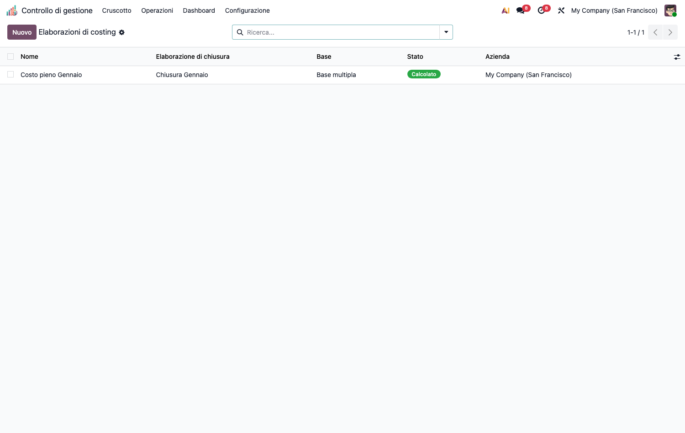
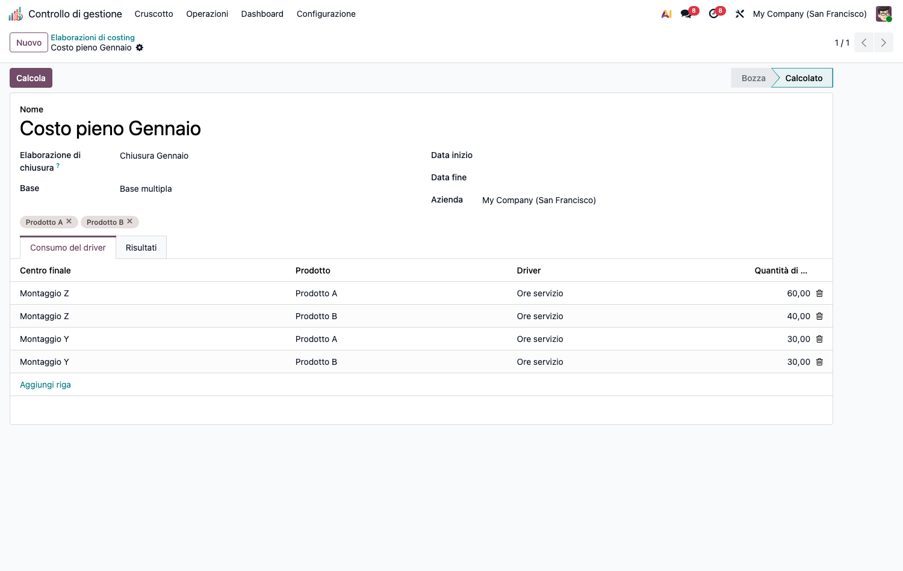

# CMC – Costo Pieno / Full Costing (cmc_full_costing)

Modulo capillare della suite CMC. Dipende da `cmc_base`.

## Obiettivo

Calcolare il **costo pieno di prodotto** su base unica o multipla, articolato nei
**4 livelli**:

1. **Costo primo** (materie prime + manodopera diretta, da `standard_price`)
2. **Costo industriale** (+ costi indiretti di produzione dal ribaltamento)
3. **Costo complessivo** (+ costi di periodo: commerciali, amministrativi)
4. **Costo economico-tecnico** (+ costi figurativi: interessi di computo, ecc.)

Include la riconciliazione vs `standard_price` con evidenza degli scostamenti.

## Configurazione (step-by-step)

1. Installa `cmc_full_costing` (richiede `cmc_base`).
2. Assicurati di avere una **base di costo pronta**: centri, costi registrati e un
   **ribaltamento** eseguito (vedi README di `cmc_base`).
3. Imposta il **prezzo standard** dei prodotti (*Vendite/Inventario › Prodotto ›
   Costo*) — alimenta il costo primo.
4. (Opzionale) In *Calcolo costi › Costo pieno (full costing) › Costi figurativi* dichiara i costi
   figurativi (metodo *lump* o *interesse* su capitale × tasso) da imputare al livello
   economico-tecnico.

## Utilizzo (step-by-step)

1. Vai in **Calcolo costi › Costo pieno (full costing) › Elaborazioni di costing** → **Nuovo**.
2. Collega il **Ribaltamento** di riferimento (fonte dei costi indiretti).
3. Scegli la **Base**: *unica* (un solo driver) o *multipla* (un driver per centro).
4. Seleziona i **prodotti** e compila le righe *centro × prodotto × driver × quantità*.
5. Premi **Calcola**. Il risultato mostra i 4 livelli di costo per prodotto, con
   tracciabilità delle quote e lo scostamento vs prezzo standard.

   

## Note

- Estratto storicamente da `cmc_base`: contiene `cmc.costing.run/line/result/quota` +
  `cmc.costing.config` (tracciabilità livelli) + costi figurativi.
- I costi di periodo (centri marcati *di periodo* in `cmc_base`) entrano solo dal livello
  complessivo in poi, restando fuori dal ribaltamento industriale.
