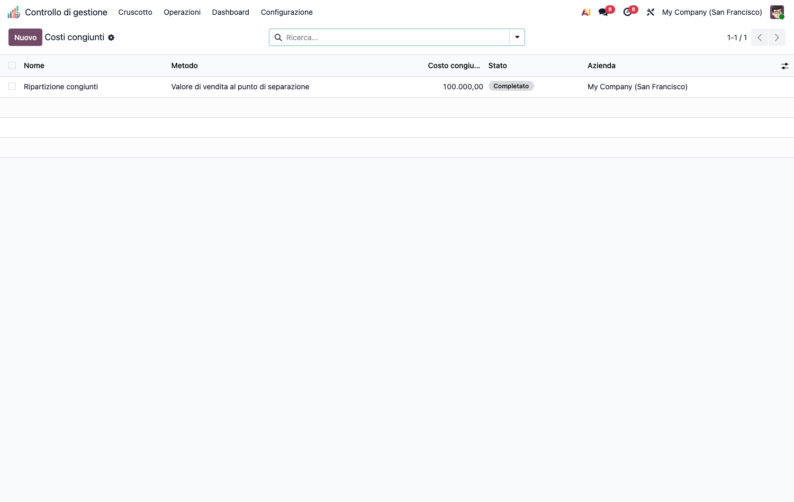
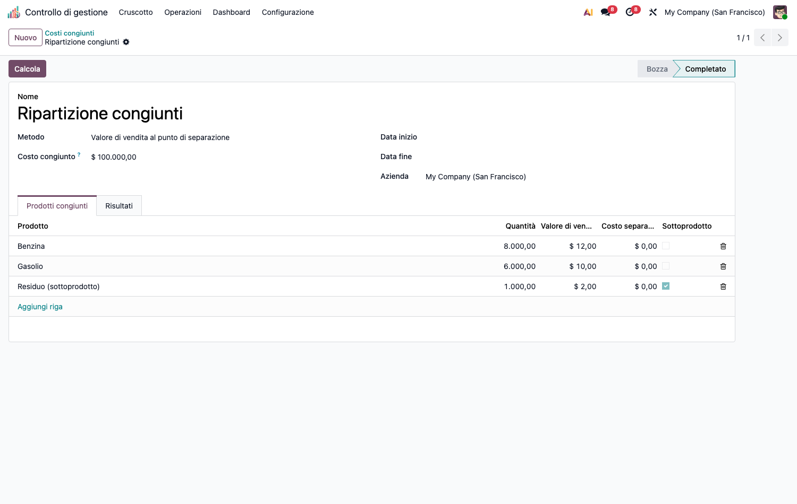
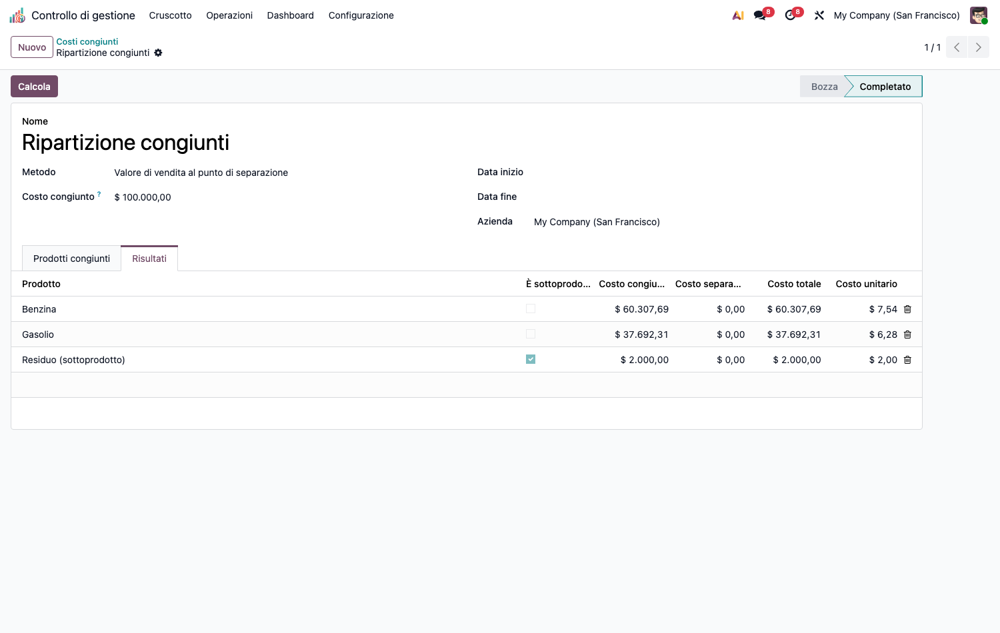

# CMC – Costi Congiunti (cmc_joint_costs)

Modulo capillare della suite CMC. Dipende da `cmc_base` e `product`.

## Obiettivo

Ripartire un **costo congiunto** di produzione tra **prodotti principali** e
**sottoprodotti**. Quattro metodi:

- **Quantità fisiche**
- **Valore di vendita al punto di separazione** (*sales value at split-off*)
- **NRV** (valore netto di realizzo)
- **Margine lordo costante** (*constant gross margin*)

I **sottoprodotti** sono valorizzati a NRV = max(qty·prezzo − costo separabile, 0) e
**nettati** dal pool prima di ripartire ai prodotti principali.

## Configurazione (step-by-step)

1. Installa `cmc_joint_costs` (richiede `cmc_base`).
2. Prepara i **prodotti** coinvolti (congiunti + eventuali sottoprodotti) in anagrafica.
3. Nessuna altra configurazione: i dati si inseriscono direttamente nel calcolo.

## Utilizzo (step-by-step)

1. **Calcolo costi › Costi congiunti › Ripartizione congiunti** → **Nuovo**.

   

2. Inserisci il **Costo congiunto** totale (input manuale) e scegli il **Metodo** di
   ripartizione.
3. Aggiungi le righe prodotto: quantità, valore di vendita unitario, costo separabile.
   Marca **Sottoprodotto** dove applicabile.
4. Premi **Calcola**. Il tab **Risultati** mostra costo allocato e costo unitario
   [(allocato + separabile) / quantità] per prodotto.

   

## Note

- Conservazione via `largest_remainder` (physical/sales/nrv); *constant_gm* mette il
  residuo sul prodotto a maggior fatturato.
- **Guardie sui casi degeneri** (falliscono con messaggio, non in silenzio): NRV di
  sottoprodotti che eccede il pool, base peso ≤ 0, fatturato totale 0, run tutto-sottoprodotti.
