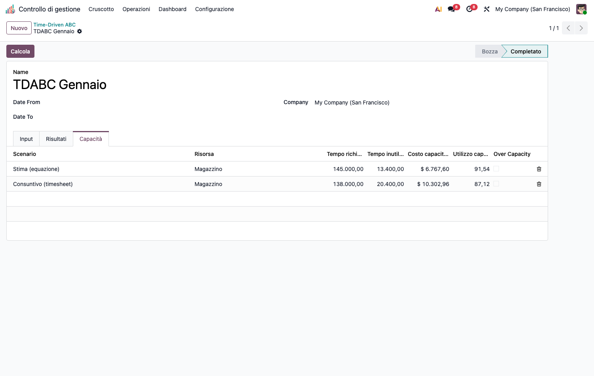
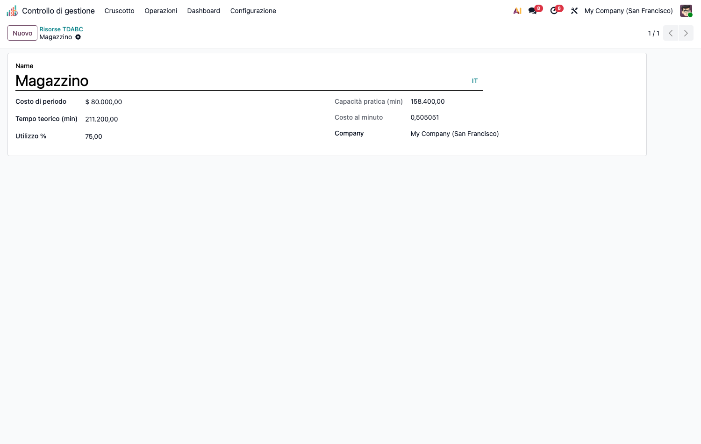
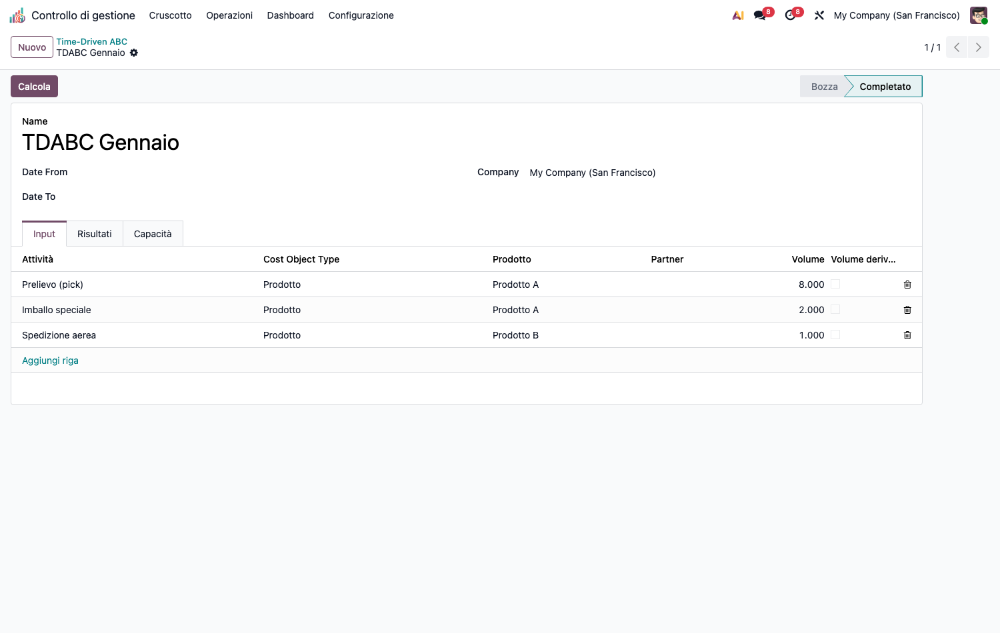
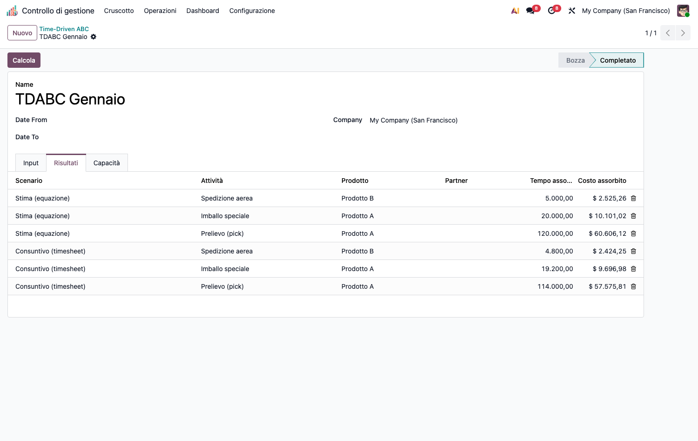

# CMC – Time-Driven ABC (cmc_tdabc)

Modulo capillare della suite CMC. Dipende da `cmc_base` e `product`.

## Obiettivo

Costeggiare prodotti **e clienti** con il TDABC, basato su **due parametri**:

1. **Capacity cost rate** (€/min) = costo della risorsa / **capacità pratica**.
2. **Tempo unitario** per transazione, via **time equation strutturata**
   (`base_time` + Σ coefficiente × caratteristica) — nessuna formula testuale, tutto parametrico.

Caratteristiche distintive:

- **Costo della capacità inutilizzata** calcolato ed **isolato** (non caricato agli
  oggetti di costo) → niente *death spiral*.
- **Doppio scenario confrontabile** in un unico calcolo: **Stima (equazione)** vs
  **Consuntivo (timesheet)** (tempo medio empirico da ore reali).
- Oggetto di costo = **prodotto** o **cliente**.

## Configurazione (step-by-step)

1. Installa `cmc_tdabc` (richiede `cmc_base`).
2. **Configurazione › Time-Driven ABC › Risorse TDABC**: crea le **risorse** con costo di
   periodo, tempo teorico (min) e **% di utilizzo** → il sistema calcola capacità pratica
   e **tariffa €/min**.

   

3. **Configurazione › Time-Driven ABC › Caratteristiche**: crea le **caratteristiche**
   riusabili (bool o numeriche, es. *Fuori misura*, *VIP*) che alimentano le equazioni.
4. Assegna i valori delle caratteristiche ai prodotti/clienti (tab *TDABC Characteristics*
   sulla scheda prodotto o cliente).
5. **Configurazione › Time-Driven ABC › Attività TDABC**: crea le **attività**, collega la
   risorsa, imposta il **tempo base** e aggiungi i **termini** dell'equazione
   (caratteristica × coefficiente).
6. (Solo scenario timesheet) tagga le righe analitiche di ore reali con il campo
   **Attività TDABC** per abilitare il confronto consuntivo.

## Utilizzo (step-by-step)

1. **Calcolo costi › Time-Driven ABC › Calcolo TDABC** → **Nuovo**.

   

2. Nel tab **Input** aggiungi le righe *attività × oggetto di costo (prodotto/cliente) ×
   volume*. Il **volume** è manuale oppure **derivato** (conteggio automatico dalle righe
   analitiche taggate, se attivi *Volume derivato*).
3. Premi **Calcola**. Il tab **Risultati** mostra, per **scenario**, il tempo assorbito e
   il costo assorbito per oggetto di costo.

   

4. Il tab **Capacità** riporta, per risorsa e scenario: tempo richiesto, tempo/costo
   **inutilizzato**, % di utilizzo e flag **over capacity** (richiesta > capacità pratica).

## Note

- **Conservazione esatta**: Σ costo assorbito + costo inutilizzato = costo della risorsa
  (la capacità inutilizzata è il residuo esatto, nessun drift di arrotondamento).
- **Standalone**: nessuna dipendenza hard da `hr_timesheet`/`account`; lo scenario
  timesheet e il volume derivato usano *runtime detection* sulle righe analitiche.
- **Guardie fail-loud**: capacità pratica ≤ 0 → errore; tempo unitario negativo → errore
  (manuale e timesheet); over capacity → segnalato (non bloccante).
